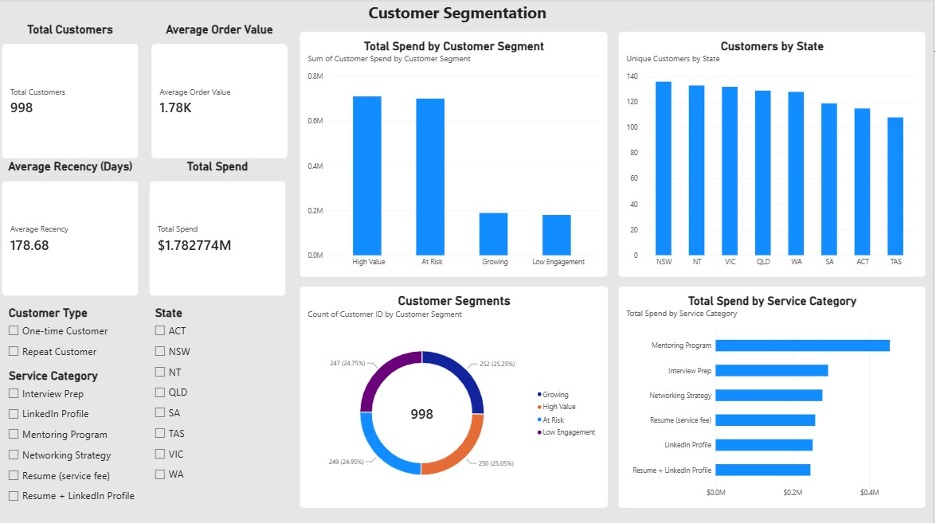

# Customer Segmentation & Recommendations — Power BI

## Dashboard Preview

## Project Overview

This project explores customer purchasing behaviour using Power BI. The aim was to understand customer spending patterns, identify different customer segments, and develop recommendations to support customer engagement and retention.

## Tools Used

- **Power BI Desktop** — dashboard development and data visualisation
- **Power Query** — data cleaning and transformation
- **DAX** — calculated measures, customer metrics and segmentation

## Project Objectives

- Analyse customer spending and purchasing behaviour.
- Calculate Total Spend, Average Order Value and Recency.
- Group customers into four segments based on spending and purchase recency.
- Build an interactive dashboard to explore customers by state, customer type and service category.
- Develop recommendations to improve customer engagement and retention.

## Data Preparation and Analysis

The Customers and Sales tables were loaded into Power BI and reviewed in Power Query. Data checks included examining missing values, checking duplicate order IDs, reviewing data types and standardising inconsistent service category names.

DAX was used to calculate customer spending, average order value, recency and customer segments. A customer summary table was also created to analyse each unique customer.

The four segments were defined using median-based thresholds for customer spend and recency:

- **High Value:** Higher spending and more recent purchases.
- **At Risk:** Higher spending but less recent purchases.
- **Growing:** Lower spending and more recent purchases.
- **Low Engagement:** Lower spending and less recent purchases.

## Key Findings

- The dataset contained **998 unique customers**.
- Total customer spend was approximately **$1.78 million**.
- Average Order Value was approximately **$1.78K**.
- Average Recency was **178.68 days**.
- Customer segments contained 250 High Value, 249 At Risk, 252 Growing and 247 Low Engagement customers.
- The Mentoring Program had the highest total spending among the service categories, at approximately **$453,321**.

## Dashboard Features

The interactive dashboard includes:

- KPI cards for Total Customers, Total Spend, Average Order Value and Average Recency.
- A donut chart showing customer segment distribution.
- A comparison of spending across customer segments.
- A chart showing unique customers by state.
- A chart comparing spending by service category.
- Slicers for Customer Type, State and Service Category.

## Recommendations

- Use targeted follow-ups to re-engage At Risk customers.
- Maintain relationships with High Value customers through relevant service recommendations.
- Encourage Growing customers to explore related career development services.
- Continue monitoring service demand and customer engagement through the dashboard.

## Learning Outcomes

This project strengthened my practical skills in Power BI, Power Query and DAX. It also helped me understand how to transform customer data into interactive visualisations and business recommendations.
